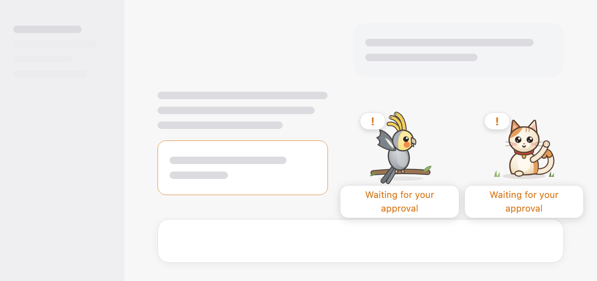
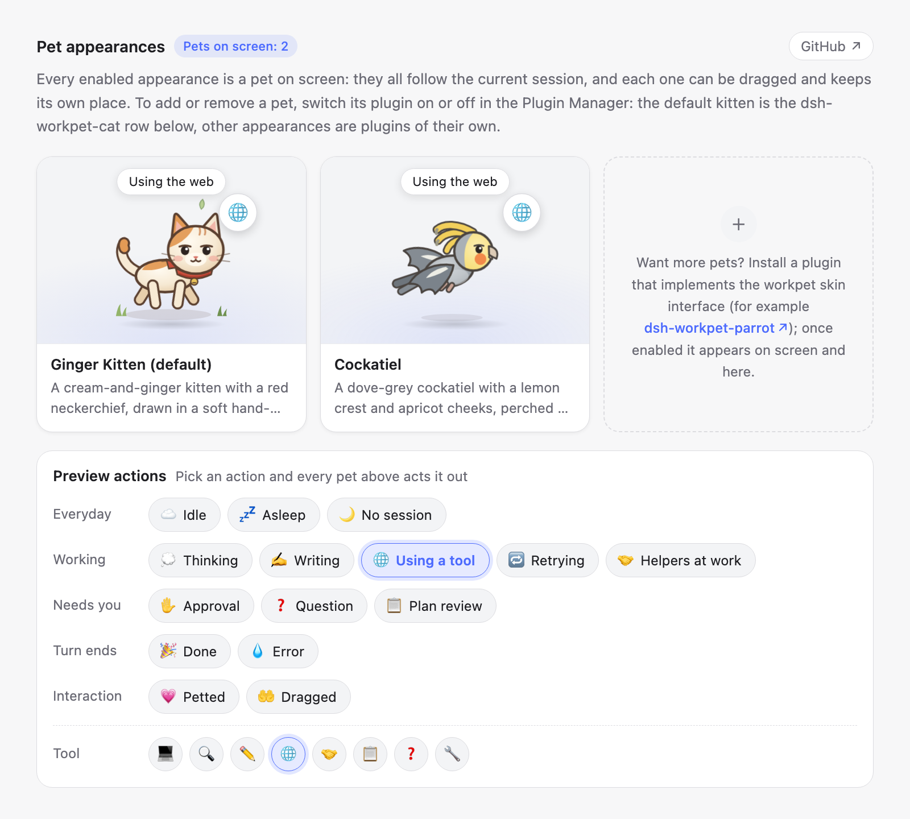
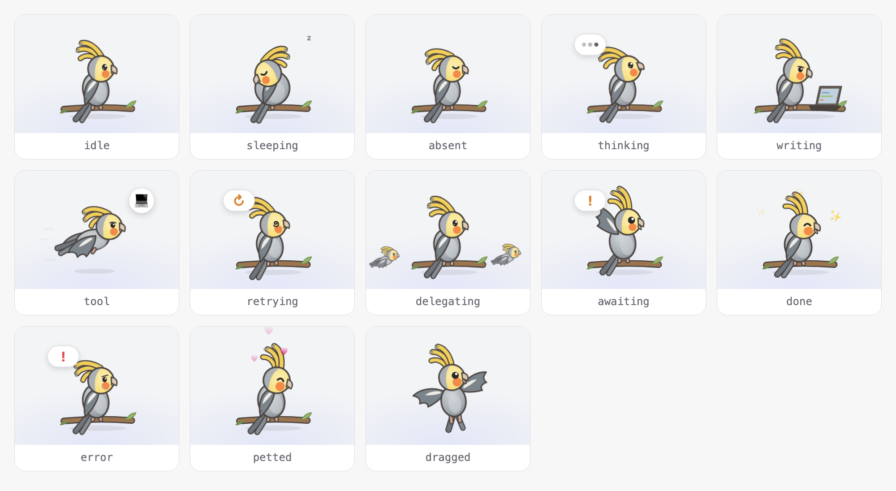

# dsh-workpet

English | [中文](README.zh.md)

A floating **work pet** for DeepSeek Harness whose actions show what the current Session is doing: it thinks, types, runs off to use tools, waves when it needs you, celebrates when a turn finishes, and dozes off when nothing happens.

The pet is a **capability** with a defined interface, not a single drawing. `dsh-workpet` owns the interface and the behavior; appearances are separate npm packages that register into it. The default appearance is a cream-and-ginger kitten in a soft, hand-painted picture-book style. Other bundles can add more: every enabled appearance is a pet of its own on screen, so you choose your pets by switching their plugins on or off.

<p align="center"></p>

## Table of Contents

- [Packages](#packages)
- [Install](#install)
- [Using it](#using-it)
- [Create your own pet](#create-your-own-pet)
- [Development](#development)
- [Documentation](#documentation)

-----

<a id="packages"></a>
## Packages

| Package | Role | Where |
|---|---|---|
| [`dsh-workpet`](packages/workpet/workpet/README.md) | Service Definition (`ctx.workpet`) + Consumer (floating pets, appearance cards, action preview); bundle | this repository |
| [`dsh-workpet-cat`](packages/workpet/workpet-cat/README.md) | Service Provider: the default kitten; installed with `dsh-workpet` | this repository |
| [`dsh-workpet-parrot`](https://github.com/lastorder/dsh-workpet-parrot) | Service Provider: a cockatiel, written as plain JavaScript with no build step; the template for new pets | separate repository |

See [docs/architecture.md](docs/architecture.md) for the roles, the interface, and the activity rules.

<a id="install"></a>
## Install

Installing the **`dsh-workpet`** bundle installs the default kitten with it: `dsh-workpet-cat` is a dependency of `dsh-workpet`, and the bundle inserts its row. Other appearances, such as `dsh-workpet-parrot`, are separate bundles.

From npm, in a Harness session, ask the agent to run `plugin_manager` `install_bundle`:

```text
install_bundle  dsh-workpet          # the pet and the default kitten
install_bundle  dsh-workpet-parrot   # optional cockatiel
```

From source, build first, then install the directories:

```sh
pnpm install
pnpm run build
```

```text
install_bundle  /absolute/path/to/dsh-workpet/packages/workpet/workpet   # the pet and the default kitten
install_bundle  /absolute/path/to/dsh-workpet-parrot                     # optional cockatiel
```

For a CLI-managed profile (not the Desktop app's `desktop` profile, which only the app may change), use `dsh plugin --profile <profile> add dsh-workpet` (or `add link:/absolute/path/to/dsh-workpet/packages/workpet/workpet`), and the same for `dsh-workpet-parrot`.

Then refresh the Harness window. On DeepSeek Harness 0.2.0 and earlier, **restart the app once after the first install**: those versions read a bundle's dependencies only at start-up, so the kitten row reports "failed to import" until the restart. Later versions pick it up immediately.


<a id="using-it"></a>
## Using it

### The pets on screen

Once installed, the pets stand in the bottom-right corner of the Harness window, above the composer, and act out what the session in the main view is doing.

- **Drag** a pet anywhere. Each pet remembers its own position, also after a refresh.
- **Click** a pet (or focus it and press Enter) to pet it: it purrs, and hearts float up. Only the pet you clicked reacts.
- **Hover** a pet to see what the session is doing in a small bubble. While the session waits for you, and right after a turn finishes or fails, the bubble stays visible under every pet without hovering.
- Every pet shows the same session, so with the kitten and the cockatiel enabled, both start typing when the model writes and both wave when an approval is pending.

### Choosing your pets

There is no appearance setting: **every enabled appearance plugin is a pet on screen**. You choose your pets in the Plugin Manager.

- **Add a pet**: install an appearance bundle, such as `dsh-workpet-parrot`. It appears next to the others right away, with nothing to select.
- **Remove a pet**: switch its plugin off. The cockatiel is its own bundle in the plugin list; the default kitten is the `dsh-workpet-cat` row on the **Work Pet** bundle page, below the pet section. Switch it back on and the pet returns to where you left it.
- New pets line up to the left of the existing ones; drag them wherever you like.

### The Work Pet page

**Plugins → Work Pet** shows every pet that is on screen and lets you preview everything they can do, without waiting for a real session to fall asleep or fail.

<p align="center"></p>

- **Appearance cards**: one card per enabled appearance, with its name, its description, and a small stage where the pet acts out the chosen action with its status bubble. The last card explains how to get more pets and links to [dsh-workpet-parrot](https://github.com/lastorder/dsh-workpet-parrot); with no pet enabled it tells you how to bring the kitten back. The **GitHub** button next to the title opens this repository, with this guide, in your browser.
- **Preview actions**: every action is a button, grouped into *Everyday*, *Working*, *Needs you*, *Turn ends*, and *Interaction*. Press one and it is highlighted, and every pet above switches to that action at once, so you can compare them side by side.
- **Tool**: when *Using a tool* is selected, a row of tool families (terminal, search, editor, web, subagent, plan, question, other) appears; each one changes the badge the pets wear.

### What the pets do

| Session state | Activity | Kitten |
|---|---|---|
| No session open | `absent` | Sits with eyes closed |
| Idle | `idle` | Sits, blinks, sways its tail |
| Idle for a while | `sleeping` | Curls up asleep |
| Model thinking | `thinking` | Tilts its head and looks up |
| Model writing | `writing` | Types on a little laptop |
| Tool running | `tool` | Runs through drifting leaves, with a tool badge |
| Retrying a request | `retrying` | Dizzy spiral eyes |
| Waiting for approval / an answer / a plan review | `awaiting` | Waves a paw |
| Subagents running | `delegating` | Watches its helper kittens |
| Turn finished | `done` | Jumps for joy |
| Turn failed | `error` | Droopy ears and a tear |
| Petted | `petted` | Purrs with eyes closed |
| Being dragged | `dragged` | Dangles and kicks |

<p align="center"></p>

The cockatiel from [dsh-workpet-parrot](https://github.com/lastorder/dsh-workpet-parrot) has its own pose for every activity:

<p align="center"></p>

<a id="create-your-own-pet"></a>
## Create your own pet

Start from **[dsh-workpet-parrot](https://github.com/lastorder/dsh-workpet-parrot)**. It is a complete appearance in one plain-JavaScript file with no build step and no TypeScript, so almost everything you edit is the drawing itself:

1. Copy the repository and rename the package, the Loader row in `cordis.patch.yml`, the `id` in `window.__ModuleLoader__.load`, the skin `id`, and the `wpp-` CSS prefix.
2. Replace the artwork in `client.js`: a palette, body parts, and one pose per activity, as SVG markup in a 100 × 80 box. Its README lists every activity, the building blocks, and the animation rules.
3. Install it as its own bundle next to `dsh-workpet` with `install_bundle`, and it appears on screen next to the kitten. Open **Plugins → Work Pet** and press the action buttons to check every pose.

The interface the pet implements (`WorkpetSkin`, `WorkpetScene`, `ctx.workpet`) is described in [docs/architecture.md](docs/architecture.md#the-interface). A compiled TypeScript appearance follows [`dsh-workpet-cat`](packages/workpet/workpet-cat) instead.

<a id="development"></a>
## Development

```sh
pnpm run build       # every package: lib/index.js, lib/client.js (and lib/types for dsh-workpet)
pnpm run typecheck
pnpm run test        # pure scene/registry tests + smoke tests over the built bundles
pnpm run verify      # all three
```

Layout follows the DeepSeek Harness monorepo: packages live at `packages/<group>/<package>/`, and each package keeps a Host half (`src/index.ts`) and a Client half (`src/client/`). See [AGENTS.md](AGENTS.md) for conventions and the npm release procedure.

The screenshots in this README are rendered from the built bundles: after changing the UI or a drawing, run `pnpm run build`, then `node scripts/screenshots.mjs --parrot ../dsh-workpet-parrot` (needs Google Chrome and a dsh-workpet-parrot checkout); it rewrites `docs/images/`.

<a id="documentation"></a>
## Documentation

- [Architecture](docs/architecture.md): capability roles, the interface, data flow, activity precedence, writing a new appearance.
- [Package group map](packages/README.md).
