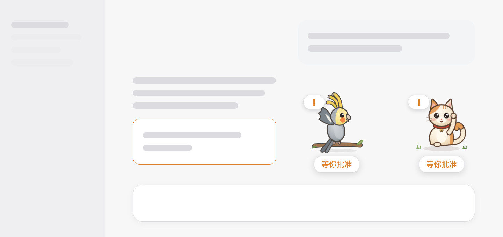
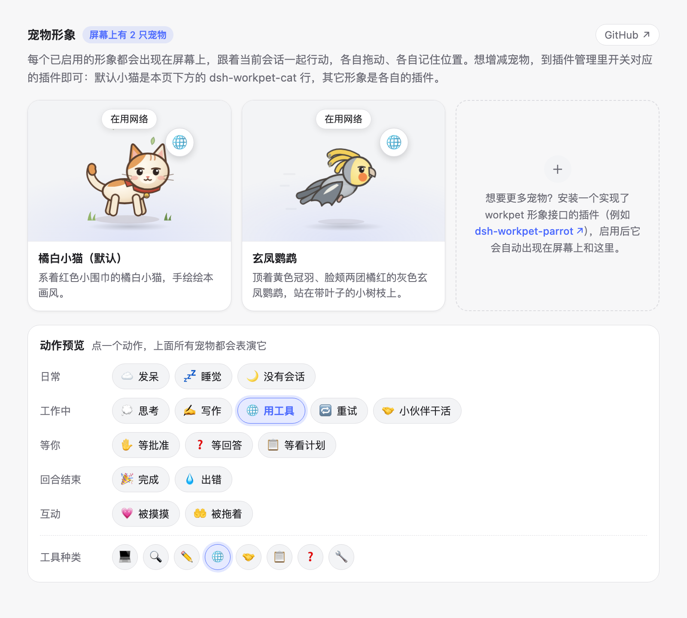

# dsh-workpet

[English](README.md) | 中文

DeepSeek Harness 的悬浮**工作宠物**，用动作表现当前会话在做什么：思考时歪头、写作时敲键盘、调用工具时跑起来、需要你时挥手、一轮结束时欢呼、闲着没事就打瞌睡。

宠物是一种定义了接口的**能力**，而不是一张固定的图。`dsh-workpet` 负责接口与行为；形象是注册进来的独立 npm 包。默认形象是一只手绘绘本画风的橘白小猫；其它组合包可以贡献更多形象：每个已启用的形象都是屏幕上单独的一只宠物，开关形象插件就能挑选要哪些宠物。

<p align="center"></p>

## 目录

- [包](#packages)
- [安装](#install)
- [使用](#using-it)
- [开发自己的宠物](#create-your-own-pet)
- [开发](#development)
- [文档](#documentation)

-----

<a id="packages"></a>
## 包

| 包 | 角色 | 位置 |
|---|---|---|
| [`dsh-workpet`](packages/workpet/workpet/README.zh.md) | Service Definition（`ctx.workpet`）+ Consumer（悬浮宠物、形象卡片、动作预览）；组合包 | 本仓库 |
| [`dsh-workpet-cat`](packages/workpet/workpet-cat/README.zh.md) | Service Provider：默认小猫；随 `dsh-workpet` 一起安装 | 本仓库 |
| [`dsh-workpet-parrot`](https://github.com/lastorder/dsh-workpet-parrot) | Service Provider：玄凤鹦鹉，纯 JavaScript、免编译；开发新宠物的模板 | 独立仓库 |

角色、接口与状态规则见 [docs/architecture.zh.md](docs/architecture.zh.md)。

<a id="install"></a>
## 安装

安装 **`dsh-workpet`** 组合包时会一并装上默认小猫：`dsh-workpet-cat` 是 `dsh-workpet` 的依赖，组合包会插入它的那一行。其它形象（如 `dsh-workpet-parrot`）是独立的组合包。

从 npm 安装：在 Harness 会话里让智能体执行 `plugin_manager` 的 `install_bundle`：

```text
install_bundle  dsh-workpet          # 宠物 + 默认小猫
install_bundle  dsh-workpet-parrot   # 可选：玄凤鹦鹉
```

从源码安装：先构建，再安装目录：

```sh
pnpm install
pnpm run build
```

```text
install_bundle  /absolute/path/to/dsh-workpet/packages/workpet/workpet   # 宠物 + 默认小猫
install_bundle  /absolute/path/to/dsh-workpet-parrot                     # 可选：玄凤鹦鹉
```

如果是 CLI 管理的 profile（桌面应用的 `desktop` profile 只能由应用自己修改），用 `dsh plugin --profile <profile> add dsh-workpet`（或 `add link:/absolute/path/to/dsh-workpet/packages/workpet/workpet`），`dsh-workpet-parrot` 同理。

然后刷新 Harness 窗口。DeepSeek Harness 0.2.0 及更早版本**首次安装后需要重启一次应用**：这些版本只在启动时读取组合包的依赖，重启前小猫那一行会报 "failed to import"。更新的版本会立即生效。


<a id="using-it"></a>
## 使用

### 屏幕上的宠物

装好后，宠物们站在 Harness 窗口右下角、输入框上方，用动作表现主视图里的会话正在做什么。

- **拖动**：把宠物拖到任意位置。每只宠物各自记住位置，刷新后也还在。
- **点一下**（或者聚焦后按回车）就是摸摸它：它会眯眼呼噜、冒出爱心。只有被点的那只有反应。
- **鼠标悬停**：小气泡显示会话正在做什么。会话等你处理、一轮刚完成或出错时，每只宠物下方的气泡都会常驻，不用悬停。
- 所有宠物表现的是同一个会话：同时启用小猫和玄凤鹦鹉时，模型写作它们一起敲键盘，等你批准时它们一起挥手。

### 挑选宠物

没有“选择形象”的设置：**每个已启用的形象插件都是屏幕上的一只宠物**，在插件管理里挑选即可。

- **添加宠物**：安装一个形象组合包，例如 `dsh-workpet-parrot`。它会立刻出现在其它宠物旁边，不用做任何选择。
- **移除宠物**：关闭它的插件。玄凤鹦鹉在插件列表里是独立的组合包；默认小猫是**工作宠物**组合包页面上、宠物区域下方的 `dsh-workpet-cat` 行。重新打开后，宠物会回到你上次放的位置。
- 新宠物会排在已有宠物的左边，之后可以随意拖动。

### 工作宠物页面

**插件 → 工作宠物** 页面展示屏幕上的所有宠物，并能预览它们的每个动作，不用真的等会话睡着或出错。

<p align="center"></p>

- **形象卡片**：每个已启用的形象一张卡片，有名称、描述和一个小舞台，宠物在舞台上表演所选动作，头顶显示状态气泡。最后一张卡片说明怎样获取更多宠物，并附上 [dsh-workpet-parrot](https://github.com/lastorder/dsh-workpet-parrot) 的链接；一只宠物都没启用时，它会告诉你怎样把小猫找回来。标题旁的 **GitHub** 按钮会在浏览器里打开本仓库，也就是这份使用说明。
- **动作预览**：所有动作都是按钮，分为*日常*、*工作中*、*等你*、*回合结束*、*互动*五组。点一个就高亮它，上面所有宠物同时换成这个动作，方便并排对比。
- **工具种类**：选中“用工具”时会多出一排工具种类（终端、搜索、编辑器、网络、子智能体、计划、提问、其它），点哪个，宠物身上的角标就换成哪个。

### 宠物的动作

| 会话状态 | 活动 | 小猫 |
|---|---|---|
| 没有打开会话 | `absent` | 闭眼坐着 |
| 空闲 | `idle` | 坐着眨眼、摇尾巴 |
| 空闲一段时间 | `sleeping` | 蜷成一团睡觉 |
| 模型思考 | `thinking` | 歪头向上看 |
| 模型写作 | `writing` | 在小笔记本上打字 |
| 调用工具 | `tool` | 在飘落的树叶里奔跑，带工具角标 |
| 请求重试 | `retrying` | 螺旋眼，晕乎乎 |
| 等你批准 / 回答 / 看计划 | `awaiting` | 举爪挥手 |
| 子智能体在跑 | `delegating` | 看着身边的小猫崽 |
| 一轮完成 | `done` | 开心地跳起来 |
| 一轮失败 | `error` | 耳朵耷拉、掉眼泪 |
| 被摸 | `petted` | 眯眼呼噜 |
| 被拖拽 | `dragged` | 被拎着晃腿 |

<p align="center"></p>

[dsh-workpet-parrot](https://github.com/lastorder/dsh-workpet-parrot) 的玄凤鹦鹉为每个活动也都有自己的姿势：

<p align="center"></p>

<a id="create-your-own-pet"></a>
## 开发自己的宠物

从 **[dsh-workpet-parrot](https://github.com/lastorder/dsh-workpet-parrot)** 开始。它把一个完整的形象放在一个纯 JavaScript 文件里，免编译、不用 TypeScript，所以要改的几乎全是图像本身：

1. 复制这个仓库，改掉包名、`cordis.patch.yml` 里的 Loader 行、`window.__ModuleLoader__.load` 里的 `id`、形象的 `id`，以及 CSS 前缀 `wpp-`。
2. 替换 `client.js` 里的图像：调色板、身体部件、每个状态一个姿势，都是 100 × 80 画布里的 SVG 标记。它的 README 列出了所有状态、可复用的部件和动画规则。
3. 作为独立组合包，和 `dsh-workpet` 一起用 `install_bundle` 安装，它就会出现在屏幕上小猫的旁边。打开 **插件 → 工作宠物**，点动作按钮逐个检查每个姿势。

宠物要实现的接口（`WorkpetSkin`、`WorkpetScene`、`ctx.workpet`）见 [docs/architecture.zh.md](docs/architecture.zh.md#the-interface)。如果想用 TypeScript 编译的方式写，参考 [`dsh-workpet-cat`](packages/workpet/workpet-cat)。

<a id="development"></a>
## 开发

```sh
pnpm run build       # 所有包：lib/index.js、lib/client.js（dsh-workpet 还有 lib/types）
pnpm run typecheck
pnpm run test        # 纯逻辑测试 + 构建产物冒烟测试
pnpm run verify      # 以上三项
```

目录结构仿照 DeepSeek Harness monorepo：包位于 `packages/<group>/<package>/`，每个包有 Host 半侧（`src/index.ts`）和 Client 半侧（`src/client/`）。约定和 npm 发布流程见 [AGENTS.md](AGENTS.md)。

README 里的截图是从构建产物渲染出来的：改了界面或图像后，先 `pnpm run build`，再运行 `node scripts/screenshots.mjs --parrot ../dsh-workpet-parrot`（需要 Google Chrome 和一份 dsh-workpet-parrot 代码），它会重写 `docs/images/`。

<a id="documentation"></a>
## 文档

- [架构](docs/architecture.zh.md)：能力角色、接口、数据流、状态优先级、编写新形象。
- [包分组](packages/README.md)。
