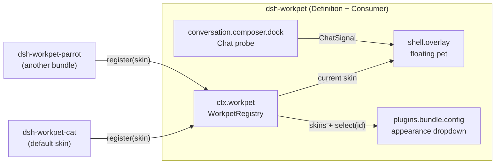

# Architecture

English | [中文](architecture.zh.md)

dsh-workpet turns "a pet that shows what the Session is doing" into a **capability** of DeepSeek Harness, built the same way the Harness builds its own capabilities (model providers, shell executors, filesystem access): one capability with three roles, each role in its own npm package when the roles evolve independently.

## Table of Contents

- [Capability roles](#capability-roles)
- [Packages and composition](#packages-and-composition)
- [The interface](#the-interface)
- [Data flow](#data-flow)
- [Activity precedence](#activity-precedence)
- [Selection and the configuration page](#selection-and-the-configuration-page)
- [Writing a new appearance](#writing-a-new-appearance)
- [Limitations](#limitations)

-----

<a id="capability-roles"></a>
## Capability roles

| Role | What it owns | Package |
|---|---|---|
| **Service Definition** | `ctx.workpet` (`WorkpetService`): the skin registry, the user's selection, and the vocabulary types (`WorkpetScene`, `WorkpetSkin`, …) | `dsh-workpet` |
| **Service Provider** | One appearance: a `WorkpetSkin` whose `Figure` draws the creature for any scene | `dsh-workpet-cat` (default), `dsh-workpet-parrot` (separate repository), any third party |
| **Consumer** | Reads the main-view Session, derives one `WorkpetScene` per render, and draws the selected skin: the floating pet, its Chat probe, and the appearance dropdown | `dsh-workpet` |

The Definition and the Consumer share one package because they are one concern: the registry exists to feed the floating pet, and the dropdown edits the registry's selection. Providers depend on the Definition only through types; at runtime they receive `ctx.workpet` by dependency injection and never import its code.



<a id="packages-and-composition"></a>
## Packages and composition

Packages live at `packages/<group>/<package>/`; the `workpet` group holds this capability family.

| Package | Loader row | Host half | Client half |
|---|---|---|---|
| `dsh-workpet` | `dsh-workpet` | no-op `apply` | provides `ctx.workpet`; registers the overlay, the probe, and the configuration page |
| `dsh-workpet-cat` | `dsh-workpet-cat` | no-op `apply` | `inject = ['workpet', 'locale']`; registers skin `cat` |

Every package is its own **bundle** with a one-row `cordis.patch.yml`. The Loader resolves row names from the profile directory, which holds only packages installed into the profile, so a bundle cannot ship a row for a package it merely depends on. Install `dsh-workpet` first, then `dsh-workpet-cat` and any other appearance. The kitten is the default because its `order` (0) sorts first; switching its bundle off leaves the other appearances.

Both Host halves are empty. A Client half reaches the browser only when a Loader row names its package, so each package keeps a row.

Two independent edges keep start-up order correct:

- `dsh.client.inject: ["dsh-workpet"]` in a provider's `package.json` makes the module table deliver the capability's factory first.
- `export const inject = ['workpet', ...]` in the provider's Client half makes Cordis activate the provider only while `ctx.workpet` exists, and dispose it when the capability goes away.

<a id="the-interface"></a>
## The interface

The complete contract is `packages/workpet/workpet/src/client/contract.ts`, published as the type-only entry `dsh-workpet/contract`.

```ts
type WorkpetActivity =
  | 'absent' | 'idle' | 'sleeping' | 'thinking' | 'writing' | 'tool' | 'retrying'
  | 'awaiting' | 'delegating' | 'done' | 'error' | 'petted' | 'dragged'

interface WorkpetScene {
  readonly activity: WorkpetActivity
  readonly tool?: { readonly name: string; readonly category: WorkpetToolCategory } // when 'tool'
  readonly awaiting?: 'approval' | 'question' | 'plan-review' | 'other'               // when 'awaiting'
  readonly helpers: number                                                            // running child agents
}

interface WorkpetSkin {
  readonly id: string        // stable, [a-z0-9-]+; the selection is stored by id
  readonly order?: number    // dropdown order; the first skin is the fallback
  title(): string            // localized, read at render time
  description?(): string
  readonly Figure: ComponentType<{ scene: WorkpetScene; compact?: boolean }>
}

interface WorkpetService {            // ctx.workpet
  readonly stage: { width: 100; height: 80 }
  register(skin: WorkpetSkin): () => void
  select(id: string): void
  getSnapshot(): { skins; selectedId; current }
  subscribe(listener: () => void): () => void
}
```

Responsibilities are split so every appearance gets the same behavior:

- A **Figure** draws only the creature, into `viewBox="0 0 100 80"`, for every activity. It may simplify itself when `compact` is set (helper companions, previews).
- The **Consumer** owns position, dragging, petting, the status bubble, the tool badge (💻 🔍 ✏️ 🌐 🤝 📋 ❓ 🔧), helper companions (up to two small copies of the same Figure), and effects: hearts, sparkles, `z`, `!`, `?`, `…`, `↻`.
- A Figure that throws is contained by an error boundary; the slot and the rest of the page keep working.

<a id="data-flow"></a>
## Data flow

1. **Probe** (`conversation.composer.dock`, Session scope, renders nothing). Reads the Session's Chat target through the standard `useChat` hook — `legacy.runningCalls`, `legacy.partial`, `legacy.nodes` — and publishes a `ChatSignal`: the live activity (tool, retrying, writing, thinking) and whether the newest settled node is a turn error.
2. **Overlay** (`shell.overlay`, root scope). Reads the standard `useSessions`, `useSessionStatus`, and `usePanelInfo` hooks: the main-view Session is the one whose `retainedBy.mainView` count is positive; `running` and `pendingInteraction` come from its status; helpers are the running entries of its `subagentCatalog` projection. It joins these facts with the probe's signal and local interaction state and calls `deriveScene`.
3. **Skin**. The overlay renders `snapshot.current.Figure` with the scene.

The plugin adds no Host service, no network request, and no session event; it reads the same Client state the conversation view renders.

<a id="activity-precedence"></a>
## Activity precedence

`deriveScene` (`src/client/scene.ts`) applies the first matching rule:

| # | Condition | Activity |
|---|---|---|
| 1 | No main-view Session | `absent` |
| 2 | The user is dragging the pet | `dragged` |
| 3 | Clicked within 1.6 s, and the Session is neither running nor waiting | `petted` |
| 4 | `pendingInteraction` is set | `awaiting` (`approval` / `question` / `plan-review` / `other`) |
| 5 | Running, probe sees a running tool call | `tool` |
| 6 | Running, newest settled node is a scheduled retry | `retrying` |
| 7 | Running, the streaming step has visible text or reasoning | `writing` |
| 8 | Running otherwise | `thinking` |
| 9 | Idle with running child agents | `delegating` |
| 10 | Just stopped (2.6 s) | `done` |
| 11 | Just stopped with a turn error (5.2 s) | `error` |
| 12 | Idle for 70 s | `sleeping` |
| 13 | Otherwise | `idle` |

The status bubble shows on hover and stays visible for `awaiting`, `done`, and `error`.

<a id="selection-and-the-configuration-page"></a>
## Selection and the configuration page

The bundle page in **Plugins → Work Pet** carries a section contributed through the `plugins.bundle.config` slot, keyed by the package name `dsh-workpet`:

- an **Appearance** dropdown listing every registered skin, in `order`; choosing one calls `ctx.workpet.select(id)` and the overlay switches immediately;
- a **Preview activity** dropdown and a live preview stage that draws the selected skin in any activity.

The selection is a Client preference stored in `localStorage` under `dsh-workpet:skin` and followed across tabs through the `storage` event. When the stored id is not registered (its bundle is off or uninstalled), the first skin is drawn and the page says so; the stored id is kept, so the choice returns when the bundle does.

<a id="writing-a-new-appearance"></a>
## Writing a new appearance

A provider is a bundle with one Loader row and a Client half. It can take either form:

- **Compiled** (like `dsh-workpet-cat`): TypeScript/TSX sources, `import type` from `dsh-workpet/contract`, built by `scripts/build.mjs`.
- **No build** (like [`dsh-workpet-parrot`](https://github.com/lastorder/dsh-workpet-parrot), a separate repository and the recommended template): one hand-written `client.js` that calls `window.__ModuleLoader__.load` itself, uses `React.createElement`, and draws with SVG markup strings. Its README is a step-by-step guide to drawing a skin.

Either way:

1. `package.json`: `dsh.bundle.patch`, a `./client` export, and `dsh.client.inject: ["dsh-workpet"]`.
2. `cordis.patch.yml`: insert one row named after the package.
3. Client half:

   ```ts
   import type { WorkpetProviderContext, WorkpetSkin } from 'dsh-workpet/contract'

   export const inject = ['workpet', 'locale']

   export function apply(ctx: WorkpetProviderContext): void {
     ctx.effect(() => ctx.locale.register('mySkin', { en, zh }))
     const t = ctx.locale.bind('mySkin')
     const skin: WorkpetSkin = { id: 'axolotl', order: 20, title: () => t('title'), Figure: AxolotlFigure }
     ctx.effect(() => ctx.workpet.register(skin))
   }
   ```

4. The Client half must be a classic script that calls `window.__ModuleLoader__.load({ id: '<package name>', factory })`; `react` and `react/jsx-runtime` arrive through the factory's `require` and are never bundled. `scripts/build.mjs` emits this format from sources; a no-build skin writes it directly.
5. Draw every activity; give gradient and clip ids per instance (`useId`), because companions render several Figures at once; prefix CSS classes and honor `prefers-reduced-motion`.

<a id="limitations"></a>
## Limitations

- The pet mirrors only the main-view Session.
- Tool categories come from tool-name patterns, not from tool metadata.
- `legacy` is the Chat target's compatibility slice; if a future Harness drops it, the probe reports nothing and a running Session shows `thinking` until the probe is updated.
- The selection lives in the browser's `localStorage`, so each browser profile (and a Desktop window served from a different origin) keeps its own choice.
- Timings (petting, celebration, sleep) are constants in `overlay.tsx`; the Host half has no configuration channel to the browser.
