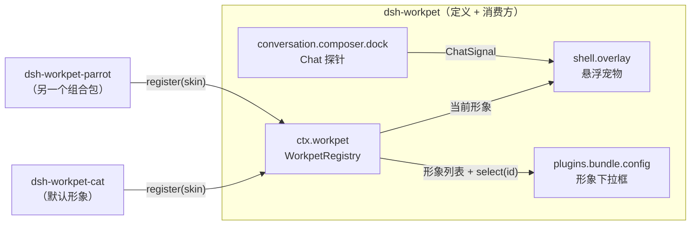

# 架构

[English](architecture.md) | 中文

dsh-workpet 把「用宠物动作表现会话状态」做成 DeepSeek Harness 的一种**能力**，构建方式与 Harness 自己的能力（模型提供方、shell 执行器、文件系统访问）一致：一个能力分三个角色，角色各自独立演进时各占一个 npm 包。

## 目录

- [能力角色](#capability-roles)
- [包与组合](#packages-and-composition)
- [接口](#the-interface)
- [数据流](#data-flow)
- [状态优先级](#activity-precedence)
- [形象选择与配置页](#selection-and-the-configuration-page)
- [编写新形象](#writing-a-new-appearance)
- [已知限制](#limitations)

-----

<a id="capability-roles"></a>
## 能力角色

| 角色 | 负责什么 | 包 |
|---|---|---|
| **Service Definition（服务定义）** | `ctx.workpet`（`WorkpetService`）：形象注册表、用户选择，以及词汇类型（`WorkpetScene`、`WorkpetSkin` 等） | `dsh-workpet` |
| **Service Provider（服务提供方）** | 一种形象：一个 `WorkpetSkin`，其 `Figure` 能为任意场景画出这只宠物 | `dsh-workpet-cat`（默认）、`dsh-workpet-parrot`（独立仓库）、任意第三方 |
| **Consumer（消费方）** | 读取主视图会话，每次渲染推导一个 `WorkpetScene`，用当前形象绘制：悬浮宠物、Chat 探针、形象下拉框 | `dsh-workpet` |

定义与消费方放在同一个包，因为它们是同一件事：注册表只为悬浮宠物服务，下拉框修改的正是注册表里的选择。提供方只在类型层面依赖定义；运行时通过依赖注入拿到 `ctx.workpet`，不引入它的任何代码。



<a id="packages-and-composition"></a>
## 包与组合

包位于 `packages/<group>/<package>/`；`workpet` 分组承载这个能力族。

| 包 | Loader 行 | Host 半侧 | Client 半侧 |
|---|---|---|---|
| `dsh-workpet` | `dsh-workpet` | 空 `apply` | 提供 `ctx.workpet`；注册悬浮宠物、探针和配置页 |
| `dsh-workpet-cat` | `dsh-workpet-cat` | 空 `apply` | `inject = ['workpet', 'locale']`；注册形象 `cat` |

每个包都是独立的**组合包（bundle）**，`cordis.patch.yml` 只插入一行。Loader 从 profile 目录解析行名，而 profile 里只有装进去的包，所以组合包不能替它仅仅依赖的包插入行。先装 `dsh-workpet`，再装 `dsh-workpet-cat` 和其它形象。小猫之所以是默认形象，是因为它的 `order`（0）排在最前；关闭它的组合包后剩下其它形象。

两个 Host 半侧都是空的。只有当某个 Loader 行指名该包时，它的 Client 半侧才会被送到浏览器，所以每个包都保留一行。

两条相互独立的边保证启动顺序：

- 提供方 `package.json` 里的 `dsh.client.inject: ["dsh-workpet"]` 让模块表先送达能力包的工厂函数。
- 提供方 Client 半侧的 `export const inject = ['workpet', ...]` 让 Cordis 只在 `ctx.workpet` 存在时激活它，并在能力消失时释放它。

<a id="the-interface"></a>
## 接口

完整契约见 `packages/workpet/workpet/src/client/contract.ts`，以纯类型入口 `dsh-workpet/contract` 发布。

```ts
type WorkpetActivity =
  | 'absent' | 'idle' | 'sleeping' | 'thinking' | 'writing' | 'tool' | 'retrying'
  | 'awaiting' | 'delegating' | 'done' | 'error' | 'petted' | 'dragged'

interface WorkpetScene {
  readonly activity: WorkpetActivity
  readonly tool?: { readonly name: string; readonly category: WorkpetToolCategory } // activity 为 'tool' 时存在
  readonly awaiting?: 'approval' | 'question' | 'plan-review' | 'other'               // activity 为 'awaiting' 时存在
  readonly helpers: number                                                            // 正在运行的子智能体数
}

interface WorkpetSkin {
  readonly id: string        // 稳定的 [a-z0-9-]+；用户选择按 id 保存
  readonly order?: number    // 下拉框顺序；排第一的形象是兜底
  title(): string            // 本地化名称，渲染时读取
  description?(): string
  readonly Figure: ComponentType<{ scene: WorkpetScene; compact?: boolean }>
}

interface WorkpetService {            // ctx.workpet
  readonly stage: { width: 100; height: 80 }
  register(skin: WorkpetSkin): () => void
  select(id: string): void
  getSnapshot(): { skins; selectedId; current }
  subscribe(listener: () => void): () => void
}
```

职责划分保证每种形象行为一致：

- **Figure** 只画宠物本身，画在 `viewBox="0 0 100 80"` 里，并覆盖全部状态。`compact` 为真时（子智能体小伙伴、预览）可以简化。
- **Consumer** 负责位置、拖拽、抚摸、状态气泡、工具角标（💻 🔍 ✏️ 🌐 🤝 📋 ❓ 🔧）、子智能体小伙伴（最多两个同一 Figure 的缩小版）以及特效：爱心、星星、`z`、`!`、`?`、`…`、`↻`。
- 抛异常的 Figure 会被错误边界拦住，slot 和页面其余部分照常工作。

<a id="data-flow"></a>
## 数据流

1. **探针**（`conversation.composer.dock`，会话作用域，不渲染任何内容）。通过标准的 `useChat` hook 读取会话的 Chat 目标——`legacy.runningCalls`、`legacy.partial`、`legacy.nodes`——发布一个 `ChatSignal`：实时活动（工具、重试、写作、思考）以及最新的已定节点是否为回合错误。
2. **悬浮宠物**（`shell.overlay`，根作用域）。读取标准的 `useSessions`、`useSessionStatus`、`usePanelInfo` hook：`retainedBy.mainView` 计数大于 0 的会话就是主视图会话；`running` 与 `pendingInteraction` 来自它的状态；小伙伴数是它的 `subagentCatalog` 投影里正在运行的条目数。把这些事实与探针信号、本地交互状态合并后调用 `deriveScene`。
3. **形象**。悬浮宠物用场景渲染 `snapshot.current.Figure`。

插件不新增 Host 服务、不发网络请求、不写会话事件；它只读取对话视图本来就在渲染的 Client 状态。

<a id="activity-precedence"></a>
## 状态优先级

`deriveScene`（`src/client/scene.ts`）按顺序取第一条命中的规则：

| # | 条件 | 状态 |
|---|---|---|
| 1 | 没有主视图会话 | `absent` |
| 2 | 用户正在拖拽宠物 | `dragged` |
| 3 | 1.6 秒内被点击，且会话既没在运行也没在等待 | `petted` |
| 4 | 存在 `pendingInteraction` | `awaiting`（`approval` / `question` / `plan-review` / `other`） |
| 5 | 运行中，探针看到正在执行的工具调用 | `tool` |
| 6 | 运行中，最新的已定节点是已排期的重试 | `retrying` |
| 7 | 运行中，流式步骤已有可见文本或推理 | `writing` |
| 8 | 其它运行情况 | `thinking` |
| 9 | 空闲但子智能体仍在运行 | `delegating` |
| 10 | 刚刚停止（2.6 秒） | `done` |
| 11 | 刚刚因回合错误停止（5.2 秒） | `error` |
| 12 | 空闲超过 70 秒 | `sleeping` |
| 13 | 其它 | `idle` |

状态气泡在鼠标悬停时出现，在 `awaiting`、`done`、`error` 时常驻。

<a id="selection-and-the-configuration-page"></a>
## 形象选择与配置页

**插件 → 工作宠物** 的组合包页面里有一块通过 `plugins.bundle.config` slot 贡献的区域，以包名 `dsh-workpet` 为 key：

- **形象**下拉框按 `order` 列出所有已注册的形象；选择后调用 `ctx.workpet.select(id)`，悬浮宠物立即切换；
- **预览动作**下拉框加一个实时预览区，可以查看当前形象在任意状态下的样子。

选择是 Client 侧偏好，保存在 `localStorage` 的 `dsh-workpet:skin` 下，并通过 `storage` 事件在多个标签页之间同步。保存的 id 没有注册时（对应组合包已关闭或卸载），绘制排第一的形象，配置页会给出提示；保存的 id 不会被清掉，组合包回来后选择也会恢复。

<a id="writing-a-new-appearance"></a>
## 编写新形象

一个提供方就是一个只有一行 Loader 行和一个 Client 半侧的组合包，有两种写法：

- **需要编译**（如 `dsh-workpet-cat`）：TypeScript/TSX 源码，从 `dsh-workpet/contract` 做 `import type`，由 `scripts/build.mjs` 构建。
- **免编译**（如独立仓库 [`dsh-workpet-parrot`](https://github.com/lastorder/dsh-workpet-parrot)，推荐作为模板）：手写一个 `client.js`，自己调用 `window.__ModuleLoader__.load`，用 `React.createElement`，用 SVG 标记字符串画图。它的 README 是一份逐步的绘制指南。

无论哪种写法：

1. `package.json`：`dsh.bundle.patch`、`./client` 导出、`dsh.client.inject: ["dsh-workpet"]`。
2. `cordis.patch.yml`：插入一行，名字就是包名。
3. Client 半侧：

   ```ts
   import type { WorkpetProviderContext, WorkpetSkin } from 'dsh-workpet/contract'

   export const inject = ['workpet', 'locale']

   export function apply(ctx: WorkpetProviderContext): void {
     ctx.effect(() => ctx.locale.register('mySkin', { en, zh }))
     const t = ctx.locale.bind('mySkin')
     const skin: WorkpetSkin = { id: 'axolotl', order: 20, title: () => t('title'), Figure: AxolotlFigure }
     ctx.effect(() => ctx.workpet.register(skin))
   }
   ```

4. Client 半侧必须是调用 `window.__ModuleLoader__.load({ id: '<包名>', factory })` 的经典脚本；`react` 与 `react/jsx-runtime` 通过工厂函数的 `require` 获得，不打进包里。`scripts/build.mjs` 从源码生成这种格式；免编译的形象直接手写这种格式。
5. 画全所有状态；渐变和裁剪 id 按实例生成（`useId`），因为小伙伴会同时渲染多个 Figure；CSS 类名加前缀，并遵守 `prefers-reduced-motion`。

<a id="limitations"></a>
## 已知限制

- 宠物只反映主视图会话。
- 工具分类按工具名匹配，不读取工具元数据。
- `legacy` 是 Chat 目标的兼容切片；如果将来的 Harness 移除它，探针将不报告任何内容，运行中的会话会一直显示 `thinking`，直到探针更新。
- 选择保存在浏览器的 `localStorage`，所以每个浏览器 profile（以及来自不同 origin 的桌面窗口）各自保存。
- 抚摸、庆祝、入睡等时长是 `overlay.tsx` 里的常量；Host 半侧没有把配置送到浏览器的通道。
