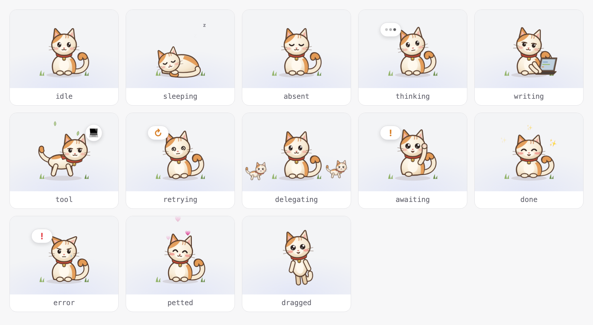

# dsh-workpet-cat

English | [中文](README.zh.md)

The default appearance of the work pet: a cream-and-ginger kitten with a red neckerchief and a brass bell, drawn in a soft, hand-painted picture-book style (warm gradients, brown ink outlines, rosy cheeks, grass tufts, leaves drifting on the wind).

## Summary

A Service Provider for `ctx.workpet`. Its Client half declares `inject = ['workpet', 'locale']` and registers skin `cat` (`order: 0`) inside `ctx.effect`. It is not a bundle of its own: the `dsh-workpet` bundle depends on it and inserts its row `dsh-workpet-cat`, so it is installed with the pet. Switching that row off on the bundle page removes the kitten from the screen and from the appearance cards.

## Poses

| Activity | Pose |
|---|---|
| `absent` | Sitting, eyes closed |
| `idle` | Sitting, blinking, tail swaying |
| `sleeping` | Curled up, tail wrapped around, breathing slowly |
| `thinking` | Head tilted, eyes up, tail flicking |
| `writing` | Typing on a small laptop |
| `tool` | Galloping, scarf fluttering, leaves drifting |
| `retrying` | Spiral eyes, wobbling |
| `awaiting` | Waving a paw, eyes wide |
| `delegating` | Glancing left and right |
| `done` | Happy eyes, jumping |
| `error` | Droopy ears, sad eyes, a tear, shaking |
| `petted` | Eyes closed, cheeks glowing, purring |
| `dragged` | Dangling and kicking |

## Source

- `src/client/parts.tsx` — palette, head with eye and mouth variants, neckerchief, ground, leaves.
- `src/client/figure.tsx` — poses and the activity-to-pose mapping.
- `src/client/styles.ts` — `wpc-` animations; honors `prefers-reduced-motion`.
